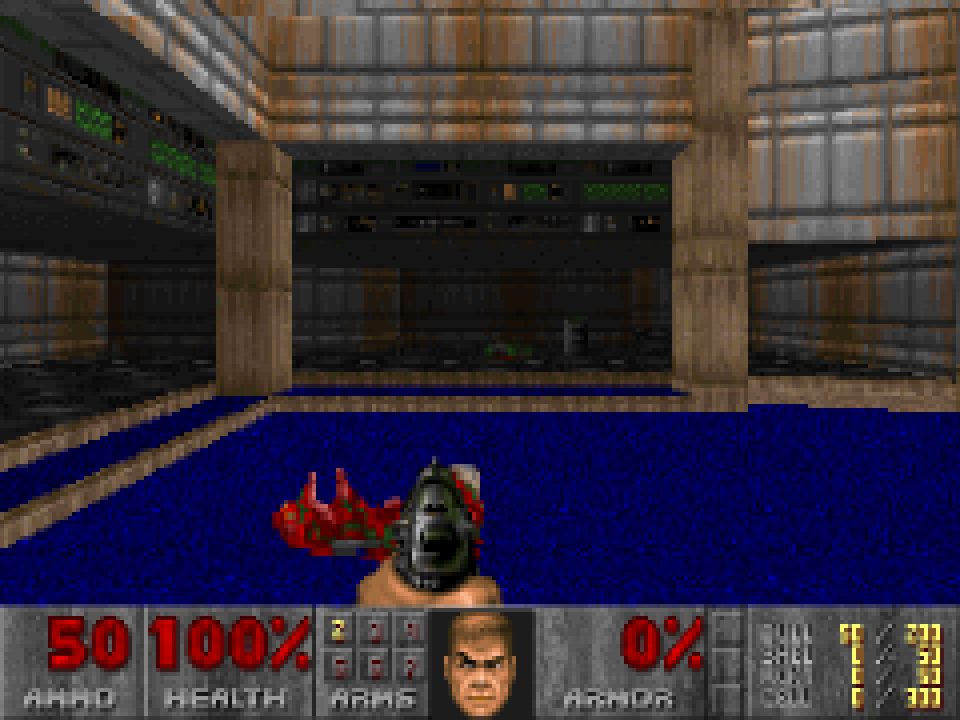
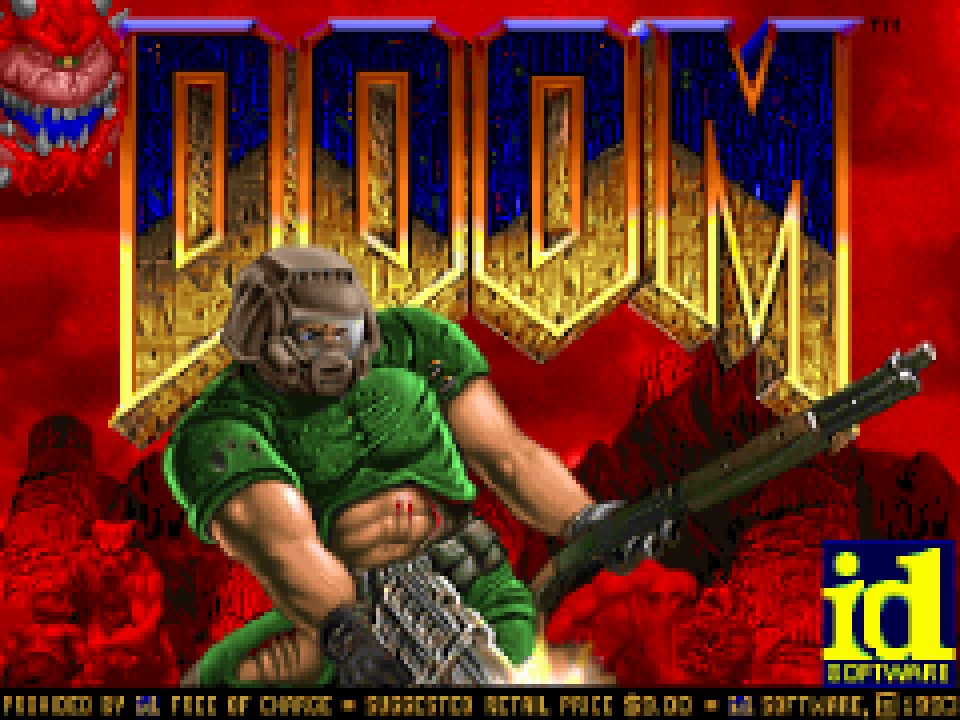

# doom-tty

The original DOOM engine running in your terminal, driven by a Rust frontend.



The id Software engine (via [doomgeneric](https://github.com/ozkl/doomgeneric)) renders into a
640×400 framebuffer; the Rust side downsamples it to 4:3, draws it with truecolor half-blocks
(`▀`, two square pixels per cell), only redraws changed cells, and feeds the keyboard back to the engine.



## Download

Every push to `main` publishes a static Linux x86_64 (musl) binary on the
[releases page](https://github.com/wcla44/doom-tty/releases/latest).

## Build and run

You need a Rust toolchain, a C compiler and an IWAD. The shareware `doom1.wad` (episode 1) is freely
distributable but not included:

```sh
mkdir -p wad
curl -sL -o wad/doom1.wad https://raw.githubusercontent.com/Akbar30Bill/DOOM_wads/master/doom1.wad
shasum wad/doom1.wad   # 5b2e249b9c5133ec987b3ea77596381dc0d6bc1d (shareware v1.9)

cargo run --release
```

Any engine argument is passed through, e.g. `cargo run --release -- -iwad doom2.wad -warp 1 -skill 4`.
The WAD is looked up in `./wad/`, `.`, `$DOOMWADDIR`, then the crate directory.

## Controls

| Key | Action |
| --- | --- |
| `W A S D` / `Z Q S D` | move / strafe (QWERTY and AZERTY) |
| `←` `→` | turn |
| `F` | fire |
| `Space` / `E` | use (doors, switches) |
| `1`–`7` | weapons |
| `Tab` | automap |
| `Esc` | menu |
| `Ctrl+C` | quit |

Cheat codes (IDDQD, IDKFA, …) work.

## Notes

- Use a terminal with truecolor and the kitty keyboard protocol (Ghostty, kitty, WezTerm) for real
  key-release events. Elsewhere (e.g. Terminal.app) releases are emulated with a timeout, so movement
  feels a bit sticky.
- A bigger window with a smaller font gives a sharper picture.
- No sound.
- Engine output goes to `$TMPDIR/doom-terminal.log`; fatal engine errors are printed on exit.
  Config and saves (`.default.cfg`, `*.dsg`) are written to the current directory.

`examples/doomlike.rs` is an unrelated, from-scratch Doom-like raycaster (`cargo run --release --example doomlike`).

## License

GPL-2.0, see [LICENSE](LICENSE). The engine in `vendor-doomgeneric/` is id Software's DOOM source
release (GPL) as adapted by Chocolate Doom and doomgeneric.
